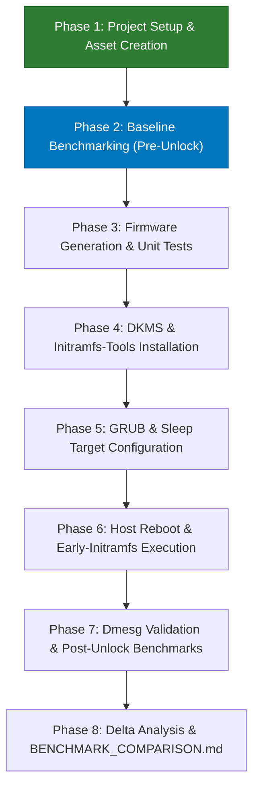

# Comprehensive GPU-Unlock Plan: Architecture, Benchmarks, Risks & Reversal

## 1. Goal Description
The objective is to install, configure, validate, and benchmark `gpu-unlock` on the host NVIDIA GeForce RTX 3090 (`GA102`, `10de:2204`).

On consumer GA102 chips, NVIDIA enforces an artificial half-rate instruction issue throttle on FP16/BF16 tensor core instructions. The `gpu-unlock` Linux kernel module sets hardware speed selection registers (`SS0=0x88888888`, `SS1=0x8`) during early userspace boot via `initramfs` before the proprietary `nvidia.ko` driver attaches, unlocking professional-equivalent full instruction issue rates without requiring vBIOS flashing or modified NVIDIA drivers.

This plan integrates:
1. **Environmental Invariants & Controls**: Clock locking (1700 MHz), uniform power cap (350W), and persistence mode to ensure isolated, mathematically reproducible measurements.
2. **Multi-Tier Benchmark Architecture**:
   - **Tier 1 (Compute Microbenchmark)**: Dense GEMM matrix multiplication in BF16, FP16, and TF32 ($M=N=K \in [2048, 4096, 8192]$) measuring TFLOPS and latency via PyTorch CUDA.
   - **Tier 2 (Realistic LLM Serving)**: Real-world inference throughput on `qwen3.8:27b-q4_K_M` across 4 prompt tiers separating prompt prefill (`prompt_eval_rate` - compute bound) from token decode (`eval_rate` - memory bandwidth bound).
3. **Safety & Invariant Guarantees**: Specific PCI bus ID targeting (`0000:01:00.0`), display drop mitigation (`nvidia-drm.modeset=1`), sleep target masking, and an automated emergency rollback script.
4. **End-to-End Validation & Reporting**: Baseline execution, module build & installation, reboot & dmesg validation, unlocked execution under identical controls, and automatic generation of `BENCHMARK_COMPARISON.md`.

---

## 2. Invariant Guarantees & Risk Analysis

### Technical Invariants
* **EEPROM / VBIOS Safety Invariant**: The module only reads physical ROM (`NV_PROM_DATA` via `work->bar + 0x300000`). It contains zero SPI flash programming or erase opcodes.
* **Volatility Invariant**: Register states are volatile. A cold power cycle or removing boot arguments returns silicon to factory defaults.
* **Explicit Target Guard**: The module remains inactive unless explicitly triggered via `gpu_unlock.targets=`.

### Risk Matrix & Automated Mitigations

| Risk Domain | Primary Failure Mode | Root Cause / Mechanism | Severity | Automated Mitigation |
| :--- | :--- | :--- | :--- | :--- |
| **System Boot** | Black screen / display drop | FLR evicts `efifb`/`simpledrm` before `nvidia-drm.modeset=1` binds. | Medium | Target specific PCI ID (`0000:01:00.0`); ensure `nvidia-drm.modeset=1` is enforced. |
| **Kernel / Host** | Early initramfs boot hang | Falcon polling timeout or unhandled MMIO response (`0xbadfxxxx`). | Medium | Reboot with `gpu_unlock.targets=` stripped via bootloader. |
| **System Sleep** | Post-suspend panic / wake lockup | Re-executing unlock under `PM_POST_SUSPEND` before `nvidia.ko` resumes. | Medium | Mask S3 sleep targets globally (`systemctl mask sleep.target ...`). |
| **Kernel Memory** | Host RAM corruption prevention | Falcon engine fails to quiesce during error paths. | High | Module leaks DMA buffers and pins module in memory (`__module_get`) to block writes. |
| **Physical HW** | VRM degradation / thermal stress | High-density FP16/BF16 tensor switching increases localized $dI/dt$ and VRM thermals. | Medium-High | Enforce uniform power cap (350W) and monitor temps. |

### Failure Detection Signatures (Dmesg / Logs)
* `gpu_unlock: failure unlock_610.c:*`
* `gpu_unlock: early PLM failed`
* `gpu_unlock: firmware did not stop; keeping its DMA buffers until power off`
* PCIe timeouts returning `0xffffffff` or `0xbadf12xx` on BAR0
* `nvidia: probe of <PCI_ADDR> failed with error -EBUSY`

---

## 3. Emergency Reversal Procedure

The rollback script [`scripts/reversal_recovery.sh`](file:///mnt/data/code/gpu-unlock/scripts/reversal_recovery.sh) is created and ready to immediately revert the system in case of boot anomalies:
- Removes `gpu_unlock.*` parameters from `/etc/default/grub` and updates GRUB.
- Purges `gpu-unlock` DKMS module and firmware files.
- Cleans drop-ins from `/etc/initramfs-tools/conf.d/gpu-unlock.conf`.
- Unmasks system sleep targets.
- Rebuilds initramfs (`update-initramfs -u`).

Execution:
```bash
sudo ./scripts/reversal_recovery.sh
```

---

## 4. Project Assets & Repository Structure

All required directories, benchmark tools, and helper scripts have been created:

```text
/mnt/data/code/gpu-unlock/
├── PLAN.md                                    # This plan and execution checklist
├── benchmarks/
│   ├── bench_gemm.py                          # PyTorch dense GEMM suite (BF16, FP16, TF32)
│   ├── bench_llm.py                           # Ollama LLM serving suite (Qwen 27B)
│   ├── compare_benchmarks.py                  # Benchmark delta comparison & MD report generator
│   ├── baseline_gemm.json                     # (Generated in Phase 2)
│   ├── baseline_llm.json                      # (Generated in Phase 2)
│   ├── unlocked_gemm.json                     # (Generated in Phase 7)
│   └── unlocked_llm.json                      # (Generated in Phase 7)
├── scripts/
│   ├── set_benchmark_invariants.sh            # Sets persistence mode, 1700MHz clock lock, 350W limit
│   ├── reset_benchmark_invariants.sh          # Resets GPU clock locks and power limit to default
│   └── reversal_recovery.sh                   # Emergency rollback script
└── BENCHMARK_COMPARISON.md                    # Final comparison report (Generated in Phase 8)
```

---

## 5. Execution Status & Next Steps



### ✅ Phase 1: Environment Setup & Script Creation [COMPLETED]
- [x] Cloned repository and set `origin` to `git@github.com:srfrnk/gpu-unlock.git` and `upstream` to `https://github.com/Zagitta/gpu-unlock.git`.
- [x] Verified hardware compatibility: NVIDIA GeForce RTX 3090 (`GA102`, `10de:2204`), kernel `7.0.0-38-generic`, Secure Boot disabled.
- [x] Verified Ollama installation and active status with `qwen3.8:27b-q4_K_M` model ready.
- [x] Created benchmark directory [`benchmarks/`](file:///mnt/data/code/gpu-unlock/benchmarks).
- [x] Implemented [`benchmarks/bench_gemm.py`](file:///mnt/data/code/gpu-unlock/benchmarks/bench_gemm.py).
- [x] Implemented [`benchmarks/bench_llm.py`](file:///mnt/data/code/gpu-unlock/benchmarks/bench_llm.py).
- [x] Implemented [`benchmarks/compare_benchmarks.py`](file:///mnt/data/code/gpu-unlock/benchmarks/compare_benchmarks.py).
- [x] Created helper script directory [`scripts/`](file:///mnt/data/code/gpu-unlock/scripts).
- [x] Implemented [`scripts/set_benchmark_invariants.sh`](file:///mnt/data/code/gpu-unlock/scripts/set_benchmark_invariants.sh).
- [x] Implemented [`scripts/reset_benchmark_invariants.sh`](file:///mnt/data/code/gpu-unlock/scripts/reset_benchmark_invariants.sh).
- [x] Implemented [`scripts/reversal_recovery.sh`](file:///mnt/data/code/gpu-unlock/scripts/reversal_recovery.sh).
- [x] Integrated risk mitigations and removed redundant scratch playbook files.

---

### ⏳ Phase 2: Baseline Benchmarking (Pre-Unlock) [READY TO EXECUTE]
1. Apply benchmark invariants:
   ```bash
   sudo ./scripts/set_benchmark_invariants.sh
   ```
2. Run baseline Tier 1 microbenchmark in PyTorch CUDA container:
   ```bash
   docker run --rm --gpus all -v /mnt/data/code/gpu-unlock:/workspace -w /workspace cellomics-base-dl:latest \
       python3 benchmarks/bench_gemm.py benchmarks/baseline_gemm.json
   ```
3. Run baseline Tier 2 LLM serving benchmark:
   ```bash
   python3 benchmarks/bench_llm.py benchmarks/baseline_llm.json
   ```
4. Reset GPU clocks and power limits:
   ```bash
   sudo ./scripts/reset_benchmark_invariants.sh
   ```

---

### ⏳ Phase 3: Firmware Generation & Unit Tests
1. Fetch upstream pinned inputs and build local firmware:
   ```bash
   make firmware
   ```
2. Execute upstream unit test suite against mocked hardware:
   ```bash
   make test
   ```

---

### ⏳ Phase 4: Installation & Safety Configuration
1. Install DKMS module, firmware binaries, and initramfs hooks:
   ```bash
   sudo make install-firmware
   sudo make install-dkms
   sudo make install-initramfs-tools
   ```
2. Verify DKMS registration:
   ```bash
   dkms status | grep gpu-unlock
   ```

---

### ⏳ Phase 5: System Configuration & Boot Parameters
1. Mask system sleep targets:
   ```bash
   sudo systemctl mask sleep.target suspend.target hibernate.target hybrid-sleep.target
   ```
2. Backup `/etc/default/grub` to `/etc/default/grub.bak.gpu-unlock`.
3. Append `gpu_unlock.targets=0000:01:00.0 nvidia-drm.modeset=1` to `GRUB_CMDLINE_LINUX_DEFAULT`.
4. Update initramfs and grub:
   ```bash
   sudo update-initramfs -u
   sudo update-grub
   ```

---

### ⏳ Phase 6: System Reboot
Reboot host system to trigger initramfs execution before `nvidia.ko` attaches:
```bash
sudo reboot
```

---

### ⏳ Phase 7: Post-Reboot Verification & Benchmarking
1. Validate kernel execution log:
   ```bash
   dmesg | grep -i gpu_unlock
   ```
   Confirm `SS0=0x88888888` applied, FLR reset completed, and device handed off cleanly.
2. Confirm GPU recognition via `nvidia-smi`.
3. Apply identical benchmark invariants:
   ```bash
   sudo ./scripts/set_benchmark_invariants.sh
   ```
4. Run unlocked Tier 1 microbenchmark:
   ```bash
   docker run --rm --gpus all -v /mnt/data/code/gpu-unlock:/workspace -w /workspace cellomics-base-dl:latest \
       python3 benchmarks/bench_gemm.py benchmarks/unlocked_gemm.json
   ```
5. Run unlocked Tier 2 LLM serving benchmark:
   ```bash
   python3 benchmarks/bench_llm.py benchmarks/unlocked_llm.json
   ```
6. Reset GPU clocks and power limits:
   ```bash
   sudo ./scripts/reset_benchmark_invariants.sh
   ```

---

### ⏳ Phase 8: Analysis & Final Comparison Report
1. Run comparison script:
   ```bash
   python3 benchmarks/compare_benchmarks.py
   ```
2. Inspect [`BENCHMARK_COMPARISON.md`](file:///mnt/data/code/gpu-unlock/BENCHMARK_COMPARISON.md) for full delta quantification across precisions and LLM serving tasks.
