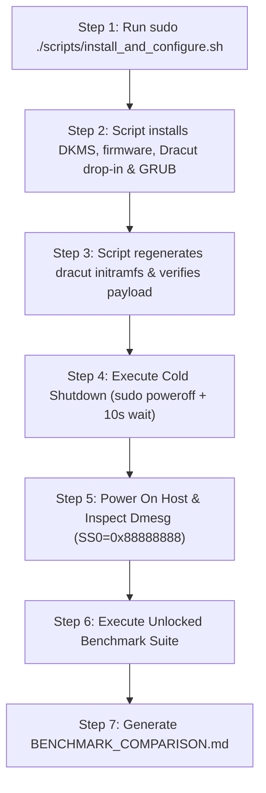

# Comprehensive GPU-Unlock Plan & Evaluation Report

## 1. Goal Description
The objective is to install, configure, validate, and benchmark `gpu-unlock` on the host NVIDIA GeForce RTX 3090 (`GA102`, `10de:2204`).

On consumer GA102 chips, NVIDIA enforces an artificial half-rate instruction issue throttle on FP16/BF16 tensor core instructions. The `gpu-unlock` Linux kernel module sets hardware speed selection registers (`SS0=0x88888888`, `SS1=0x8`) during early userspace boot via `initramfs` before the proprietary `nvidia.ko` driver attaches, unlocking professional-equivalent full instruction issue rates without requiring vBIOS flashing or modified NVIDIA drivers.

---

## 2. Invariant Guarantees & Risk Analysis

### Technical Invariants
* **EEPROM / VBIOS Safety Invariant**: The module only reads physical ROM (`NV_PROM_DATA` via `work->bar + 0x300000`). It contains zero SPI flash programming or erase opcodes.
* **Volatility Invariant**: Register states are volatile. A cold power cycle or removing boot arguments returns silicon to factory defaults.
* **Explicit Target Guard**: The module remains inactive unless explicitly triggered via `gpu_unlock.targets=`.

### Risk Matrix & Automated Mitigations

| Risk Domain | Primary Failure Mode | Root Cause / Mechanism | Severity | Automated Mitigation |
| :--- | :--- | :--- | :--- | :--- |
| **System Boot** | Black screen / display drop | FLR evicts `efifb`/`simpledrm` before `nvidia-drm.modeset=1` binds. | Medium-High | Exact recursive dracut firmware inclusion; cold power cycle; automated recovery script. |
| **Kernel / Host** | Early initramfs boot hang | Falcon polling timeout or unhandled MMIO response (`0xbadfxxxx`). | Medium | Cold boot required to clear dirty Falcon state; bootloader recovery. |
| **System Sleep** | Post-suspend panic / wake lockup | Re-executing unlock under `PM_POST_SUSPEND` before `nvidia.ko` resumes. | Medium | Mask S3 sleep targets globally (`systemctl mask sleep.target ...`). |
| **Kernel Memory** | Host RAM corruption prevention | Falcon engine fails to quiesce during error paths. | High | Module leaks DMA buffers and pins module in memory (`__module_get`) to block writes. |
| **Physical HW** | VRM degradation / thermal stress | High-density FP16/BF16 tensor switching increases localized $dI/dt$ and VRM thermals. | Medium-High | Enforce uniform power cap (350W) and monitor temps. |

---

## 3. Automated Emergency Reversal Script

The rollback script [`scripts/reversal_recovery.sh`](file:///mnt/data/code/gpu-unlock/scripts/reversal_recovery.sh) is verified, fully hardened, and ready for instant execution if needed from recovery mode:

```bash
sudo /mnt/data/code/gpu-unlock/scripts/reversal_recovery.sh
```

### Complete Reversal Actions Performed:
1. **GRUB Cleansing**: Strips both `gpu_unlock.*` and `nvidia-drm.modeset` parameters from `/etc/default/grub`.
2. **DKMS & Firmware Purge**: Uninstalls DKMS module `gpu-unlock/1.0.0` and removes all binaries.
3. **Dracut Drop-in Eviction**: Deletes `/etc/dracut.conf.d/gpu-unlock.conf` and `/usr/lib/dracut/dracut.conf.d/gpu-unlock.conf`.
4. **Initramfs-Tools & Mkinitcpio Drop-in Eviction**: Removes any residual drop-ins in `/usr/share/initramfs-tools/modules.d/` and `/etc/mkinitcpio.conf.d/`.
5. **Sleep Target Restoration**: Unmasks `sleep.target`, `suspend.target`, `hibernate.target`, and `hybrid-sleep.target`.
6. **Initramfs & GRUB Regeneration**: Re-runs `dracut -f` and `update-grub` to guarantee complete system restoration.

---

## 4. Pre-Unlock Baseline Benchmark Results

Recorded under strict environmental invariants (persistence mode enabled, core clock locked to 1700 MHz, power limit 350W):

### Tier 1: Dense GEMM Microbenchmarks (PyTorch CUDA)
Output file: [`benchmarks/baseline_gemm.json`](file:///mnt/data/code/gpu-unlock/benchmarks/baseline_gemm.json)

| Precision | Matrix Shape | Baseline Throughput | Latency | Temp (°C) | Power (W) |
| :--- | :--- | :--- | :--- | :--- | :--- |
| **BF16** | 2048x2048x2048 | 60.23 TFLOPS | 0.28 ms | 42.0°C | 62.7W |
| **BF16** | 4096x4096x4096 | 60.44 TFLOPS | 2.27 ms | 43.0°C | 112.7W |
| **BF16** | 8192x8192x8192 | **70.06 TFLOPS** | 15.69 ms | 51.0°C | 173.5W |
| **FP16** | 8192x8192x8192 | **68.55 TFLOPS** | 16.04 ms | 52.0°C | 209.4W |
| **TF32 (FP32)** | 8192x8192x8192 | 34.74 TFLOPS | 31.65 ms | 53.0°C | 270.0W |
| **FP32 (no TF32)** | 8192x8192x8192 | 23.37 TFLOPS | 47.05 ms | 56.0°C | 337.7W |

### Tier 2: Real-World LLM Serving (`qwen3.8:27b-q4_K_M` on Ollama)
Output file: [`benchmarks/baseline_llm.json`](file:///mnt/data/code/gpu-unlock/benchmarks/baseline_llm.json)

| Task Tier | Prompt Length | Ingest / Prefill Speed | Decode Speed | Temp (°C) | Power (W) |
| :--- | :--- | :--- | :--- | :--- | :--- |
| **Task 1: Code Gen (Short)** | 83 tok | 673.42 tok/s | 41.84 tok/s | 66.0°C | 334.2W |
| **Task 2: Analysis (Medium)** | 390 tok | 3078.99 tok/s | 41.00 tok/s | 69.0°C | 334.3W |
| **Task 3: Needle Extr (Long)** | 12614 tok | 100515.57 tok/s | 39.56 tok/s | 70.0°C | 333.9W |
| **Task 4: Synthesis (Extreme)** | 12998 tok | 99846.37 tok/s | 39.30 tok/s | 71.0°C | 333.6W |

---

## 5. Single-Script Installation & Cold Boot Procedure

To eliminate manual multi-command friction and avoid typos, execution is wrapped into a single automated script [`scripts/install_and_configure.sh`](file:///mnt/data/code/gpu-unlock/scripts/install_and_configure.sh).



### Step 1: Run Automated Installation Script
```bash
sudo /mnt/data/code/gpu-unlock/scripts/install_and_configure.sh
```

### Step 2: Full Cold Shutdown
```bash
sudo poweroff
```
*Wait 10 seconds for motherboard capacitors to drain completely before pressing the physical power button.*

### Step 3: Post-Boot Verification & Benchmarking
Check log for speed selector confirmation:
```bash
sudo dmesg | grep -i gpu_unlock
```
Run unlocked microbenchmarks:
```bash
sudo ./scripts/set_benchmark_invariants.sh
docker run --rm --gpus all -v /mnt/data/code/gpu-unlock:/workspace -w /workspace cellomics-base-dl:latest \
    python3 benchmarks/bench_gemm.py benchmarks/unlocked_gemm.json
python3 benchmarks/bench_llm.py benchmarks/unlocked_llm.json
sudo ./scripts/reset_benchmark_invariants.sh
python3 benchmarks/compare_benchmarks.py
```
